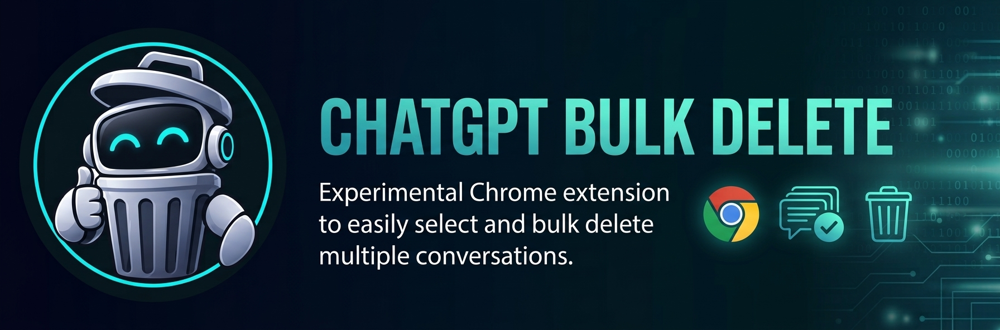
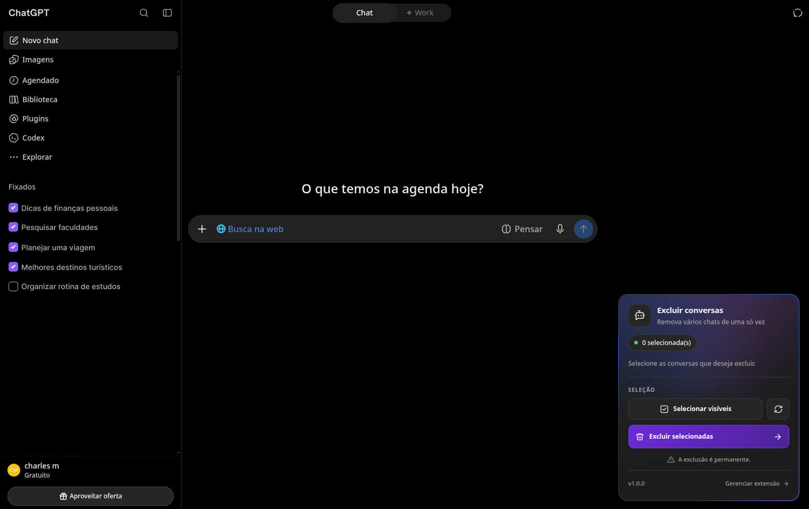
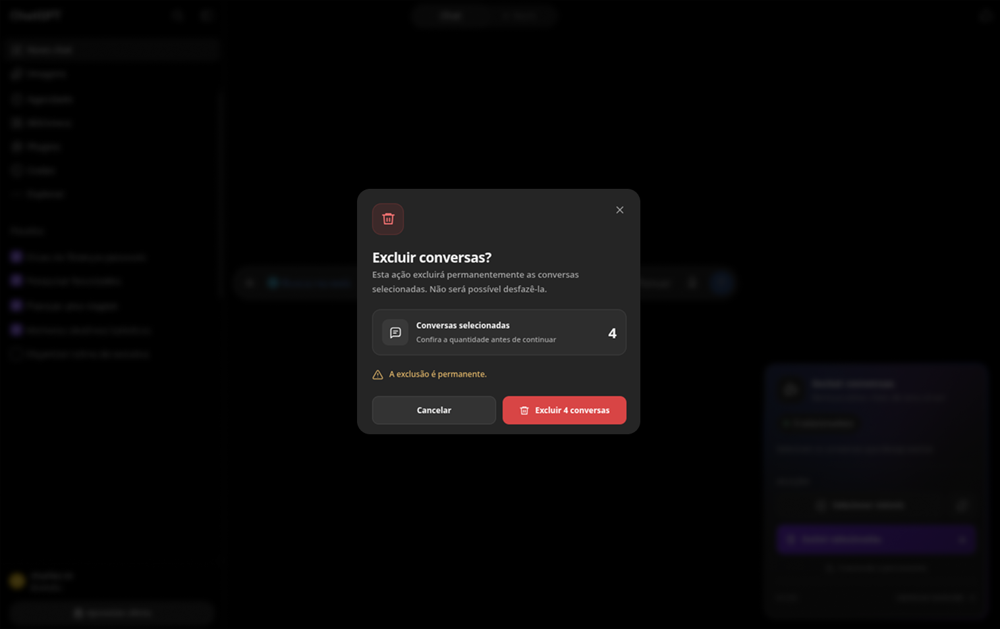

<div align="center">

<p align="center">
  
</p>

# 🗑️ ChatGPT Bulk Delete

**Simplifique o gerenciamento do seu histórico do ChatGPT com a seleção e exclusão de conversas em lote.**

[](#)
[](#)
[](#-licença)

<p align="center">
  <a href="#-sobre-o-projeto">Sobre</a> •
  <a href="#-funcionalidades">Funcionalidades</a> •
  <a href="#-prévia">Prévia</a> •
  <a href="#-instalação-manual-modo-de-desenvolvedor">Instalação</a> •
  <a href="#-como-usar">Como Usar</a> •
  <a href="#-tecnologias-utilizadas">Tecnologias</a> •
  <a href="#-estrutura-do-projeto">Estrutura</a> •
  <a href="#-licença">Licença</a> •
  <a href="#-aviso-importante">Aviso Importante</a>
</p>

</div>

---

## 📌 Sobre o Projeto

O **ChatGPT Bulk Delete** é uma extensão experimental para o **Google Chrome**, desenvolvida para facilitar o gerenciamento do histórico do ChatGPT, permitindo selecionar e excluir várias conversas de uma só vez.

A extensão adiciona caixas de seleção à lista de conversas e permite selecionar as conversas visíveis na barra lateral. Ao rolar a lista, você pode acessar outras conversas e selecioná-las também, reunindo várias conversas para exclusão em lote.

---

## ✨ Funcionalidades

- 🔘 **Seleção Individual de Conversas:** Selecione manualmente as conversas que deseja excluir.
- 👁️ **Seleção de Conversas Visíveis:** Selecione todas as conversas visíveis na barra lateral com um único clique.
- 🧹 **Limpar Seleção:** Remova todas as conversas selecionadas de uma só vez.
- ⚡ **Exclusão em Lote (Bulk Delete):** Exclua sequencialmente as conversas selecionadas.
- 🛡️ **Modal de Confirmação:** Revise a ação antes de confirmar a exclusão das conversas.
- 🎨 **Interface Integrada e Modular:** Interface integrada ao ChatGPT, com estilos CSS modulares e ícones vetoriais.

---

## 🖥️ Prévia

<table width="100%">
  <tr>
    <td width="50%" align="center">
      <b>Painel Principal e Seleção</b><br/><br/>
      
    </td>
    <td width="50%" align="center">
      <b>Confirmação e Exclusão</b><br/><br/>
      
    </td>
  </tr>
</table>
---

## 🚀 Como Usar

1. **Abra o ChatGPT:** Acesse [chatgpt.com](https://chatgpt.com/) no navegador.
2. **Selecione as conversas:** Utilize as caixas de seleção (*checkboxes*) na barra lateral ou o botão **"Selecionar Visíveis"**.
3. **Revise a seleção:** Confira o contador de conversas selecionadas na barra de ferramentas.
4. **Execute a exclusão:** Clique em **"Excluir Selecionadas"**, revise o aviso no modal de confirmação e confirme a ação.

> ⚠️ **Atenção:** Revise cuidadosamente as conversas selecionadas antes de confirmar. A exclusão de conversas no ChatGPT pode ser permanente.

---

## 📦 Instalação Manual (Modo de Desenvolvedor)

### Pré-requisitos
- [Google Chrome](https://www.google.com/chrome/) instalado.
- [Node.js](https://nodejs.org/) & [pnpm](https://pnpm.io/) configurados.
- [Git](https://git-scm.com/) para clonar o repositório.

### Passo a Passo

```bash
# 1. Clone o repositório
git clone https://github.com/charles-mrt/chat-gpt-bulk-delete.git

# 2. Acesse a pasta do projeto
cd chatgpt-bulk-delete

# 3. Instale as dependências
pnpm install

# 4. Gere os arquivos de distribuição
pnpm build
```

5. No Google Chrome, abra a página `chrome://extensions/`.
6. Ative a opção **Modo do desenvolvedor** no canto superior direito.
7. Clique em **Carregar sem compactação** (*Load unpacked*).
8. Selecione a pasta raiz do projeto (onde está localizado o ficheiro `manifest.json`).
9. Acesse o ChatGPT e atualize a página.

---

## 💻 Desenvolvimento & Workflow

Para modificar ou contribuir para o código:

```bash
# Executa o empacotador em modo de observação (Watch Mode)
pnpm watch
```

> **Nota:** O script `watch` recompila as alterações de JavaScript automaticamente. Caso modifique arquivos CSS, execute `pnpm build` para atualizar os estilos na pasta `dist/`.

---

## 🛠️ Tecnologias Utilizadas

- **Linguagens:** JavaScript (ES Modules) & CSS3
- **Plataforma:** Chrome Extensions API (Manifest V3)
- **Empacotador:** [esbuild](https://esbuild.github.io/)
- **Gerenciador de Pacotes:** [pnpm](https://pnpm.io/)

---

## 📁 Estrutura do Projeto

```text
chatgpt-bulk-delete/
├── 📄 manifest.json        # Configuração principal da Chrome Extension (V3)
├── 📄 package.json         # Scripts de build e dependências
├── 📄 pnpm-lock.yaml       # Ficheiro de bloqueio de dependências
├── 📁 assets/               
│   ├── 📁 fonts/           # Fontes
│   │   └──audiowide-regular.woff2
│   └── 📁 images/          # Banners, ícones, capturas de tela
│       ├── cover.jpeg
│       ├── icon-16.png
│       ├── icon-48.png
│       ├── icon-128.png
│       ├── screenshot-1.png
│       └── screenshot-2.png
├── 📁 dist/                # arquivos otimizados gerados pelo build
│   ├── content.js
│   └── content.css
└── 📁 src/                 # Código-fonte do projeto
    ├── 📄 background.js    # Service worker da extensão
    ├── 📄 content.js       # Ponto de entrada do content script
    ├── 📁 features/        # Módulos de seleção, exclusão e toolbar
    │   ├── 📁 bulk-delete/
    │   ├── 📁 conversations/
    │   └── 📁 toolbar/
    ├── 📁 shared/          # Recursos compartilhados (SVG Icons)
    └── 📁 styles/          # Estilos CSS modulares
```

---

## 🔒 Privacidade

A extensão foi desenvolvida para realizar a seleção e a exclusão de conversas diretamente pela interface do ChatGPT. Recomenda-se revisar o código-fonte e verificar as permissões solicitadas. O funcionamento local no navegador, por si só, não garante ausência de riscos.

---

## ⚠️ Aviso Importante

Esta extensão é um **projeto experimental e independente**, sem qualquer vínculo ou autorização oficial da **OpenAI**.

O seu funcionamento depende da estrutura da interface do ChatGPT, que pode mudar sem aviso prévio. O uso da extensão é de responsabilidade do próprio usuário.

---

## 📄 Licença

Este projeto está licenciado sob a [Licença MIT](LICENSE) - consulte o arquivo LICENSE para obter mais detalhes.

---

<div align="center">

Desenvolvido para tornar a exclusão de conversas do ChatGPT mais prática e organizada.

</div>